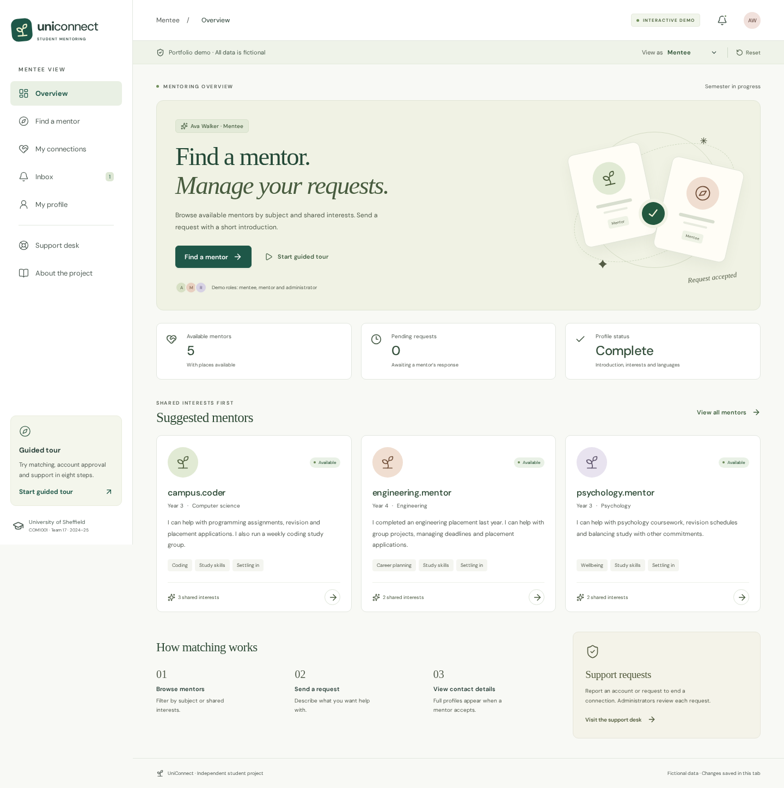

# UniConnect

**Student mentor–mentee matching demo**

An interactive portfolio of a University of Sheffield mentor–mentee matching project, originally built by Team 17 for COM1001 in 2024–25. The demo covers mentoring requests, mentor acceptance, account approvals and support, with separate views for mentees, mentors and administrators.

The original Ruby/Sinatra/SQLite application remains in this repository. The public experience is a new React/TypeScript application with fictional, browser-local data. It requires no accounts, database, server functions, or homelab connection.



[View the mobile layout](docs/screenshots/mobile.png).

## Run the portfolio

Use **Node.js 24 LTS** (`nvm use` if you use nvm).

```sh
npm ci
npm run dev
```

Open `http://127.0.0.1:5173`. For a production build with the deployment’s security headers:

```sh
npm run build
npm run preview
```

Open `http://127.0.0.1:4173`. Both servers bind to loopback. The preview serves only `dist/`.

## Explore

- **Guided tour:** eight steps covering mentoring requests, mentor acceptance, profile visibility, notifications, account approval and support. Perform actions yourself or select “Show me & continue.” The tour uses separate data and restores your previous changes on exit.
- **Mentee:** search mentors, filter by subject and interests, edit a profile, send introductions, follow requests, view an accepted connection, or ask for support.
- **Mentor:** accept or decline introductions, set availability, offer a place to a waitlisted student, and view active connections.
- **Administrator:** approve members, review support and withdrawal requests, flag accounts, set capacity, and complete the demo semester.
- **Reset:** restore the fictional starting data at any time. Changes persist across refresh in the current tab using a bounded, validated action log in `sessionStorage`. Storage-disabled browsers still work in memory.

Switch roles using **View as** above the main content. All data is fictional, all actions are simulations, and no email or message is delivered to a real person. Names and contact visibility demonstrate the original product’s rules; the synthetic fixture data itself is public. This is an independent student project, not an official university service.

## Verification

```sh
npx playwright install chromium
npm run check
npm run audit:dependencies
```

`check` runs strict TypeScript compilation, the production build, a deployment-file audit, model tests, and browser tests on desktop and mobile Chromium. Browser tests cover the entire request/withdrawal flow, tour isolation, approvals, capacity, waitlists, reset, storage failures, keyboard use, WCAG automated checks, and static security boundaries. CI also checks dependency advisories.

The portfolio’s build copies only `assets/`, never the historical `public/` directory. Hash routes support direct navigation and refresh without a server rewrite. Fonts and icons are served locally.

## Deployment and security

The recommended deployment is **static Vercel hosting only**. Nothing needs to run in the homelab, and existing Tailscale Funnel applications need no changes.

The [verified preview](https://uniconnect-portfolio-jdpnpjx29-j-ameswongs-projects.vercel.app) requires the owner's Vercel sign-in. No production deployment is retained. The complete tour has also been checked on the hosted preview at desktop and mobile sizes.

- [Deployment configuration, rationale, and exact next steps](docs/DEPLOYMENT.md)
- [Security audit, legacy findings, and limitations](docs/SECURITY.md)
- [Historical Ruby dependency findings](docs/legacy-dependencies.json)

The archived Sinatra server refuses production startup and is disabled by default outside the test environment. Its application vulnerabilities remain unresolved because it is historical source rather than the deployed runtime. Do not expose it through Funnel, a reverse proxy, or a public port.

## Source map

| Location                                            | Purpose                                                       |
| --------------------------------------------------- | ------------------------------------------------------------- |
| `src/demo/model.ts`                                 | Fictional data, validated actions, matching rules, and replay |
| `src/App.tsx`                                       | Role navigation, session persistence, and tour isolation      |
| `src/pages/`                                        | Responsive mentee, mentor, administrator, and project screens |
| `src/components/`                                   | Shared controls, accessible dialogs, and the guided tour      |
| `tests/`                                            | Model and production-browser regression tests                 |
| `scripts/`                                          | Static preview, deployment audit, and legacy startup guard    |
| `assets/`                                           | Only the public assets intended for the portfolio             |
| `controllers/`, `models/`, `views/`, `db/`, `spec/` | Original Ruby coursework source and tests                     |

The original architecture, contribution history, feature descriptions, and local coursework setup are preserved in [the historical README](docs/COURSEWORK.md). Its setup scripts replace databases; they are unnecessary for the portfolio.
